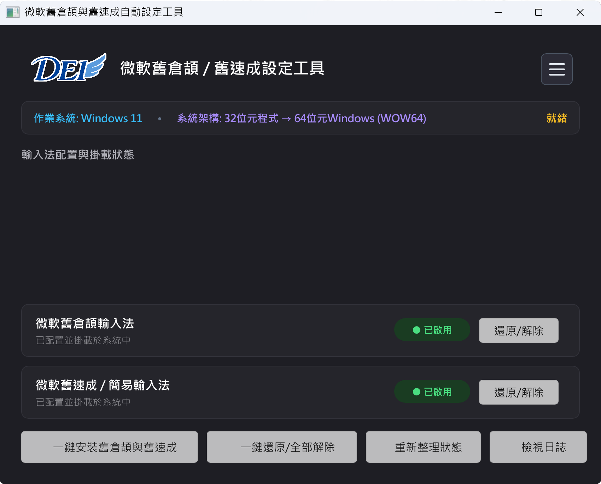

  

[繁體中文](../../README.md) · [简体中文](README_zh-CN.md) · **English**

# Windows XP Classic Changjei & Quick IME Installer

### Experience the Classic, Instant Typing Feel of Windows XP · Automated One-Click Installation & Setup
Designed for typists accustomed to classic Microsoft Changjei and Quick input feel

**Install the authentic, lightning-fast Microsoft Classic Changjei and Quick (Simple) IME from Windows XP with one click.**

[Overview](#-overview) · [Key Features](#-key-features) · [Application Screenshot](#-application-screenshot) · [Download & Usage](#-download--instructions) · [Compatibility](#-system-compatibility--requirements) · [FAQ](#-frequently-asked-questions-faq) · [Support & Feedback](#-feedback--support)

---

## 📖 Overview

During the golden era of personal computing, **Windows XP's Microsoft Classic Changjei and Quick (Simple IME)** set the gold standard with instant key response, zero latency, intuitive candidate ordering, and rock-solid compatibility.

However, as Windows evolved, Microsoft hid the installation paths for classic IMEs, while modern input methods frequently suffer from disappearing candidate boxes or input lag in various applications.

**「Windows XP Classic Changjei & Quick IME Installer」** is a clean, portable utility providing **one-click installation** and **one-click uninstallation**, making it effortless to restore the authentic classic typing experience without tedious manual setup.

---

## ✨ Key Features

### 1. ⚡ One-Click Installation of Windows XP Classic Changjei & Quick
Provides dedicated buttons to "Install Classic Changjei", "Install Classic Quick", or "Install Both". Automatically completes environment setup and layout mounting within seconds.

### 2. 🛡️ Clean Uninstallation & Rollback
If you ever need to remove the classic IMEs, the utility provides a full uninstall feature that cleanly unmounts layouts, purges residual entries, and refreshes system input services.

### 3. 📜 Real-Time Detailed Logs with One-Click Copy
Displays live diagnostic logs of every installation step and processing state. Includes a convenient "Copy Log" button for effortless troubleshooting.

---

## 📸 Application Screenshot

  

---

## 📦 Download & Instructions

### 📥 Download
1. Head over to the project's [Releases Page](https://github.com/robert820/winxp-changjei-quick-installer/releases) and download the latest standalone binary.
2. The application is a **single portable executable (PE32)** with zero external dependencies (no .NET runtime, no VC++ redistributables).

### 🚀 Usage Guide
1. Right-click the downloaded executable and select **"Run as administrator"** (installing system-wide input layouts requires administrative privileges).
2. Check your operating system detection status on the main dashboard:
   - Click **"Install Classic Changjei"** or **"Install Classic Quick"** (or **"Install Both"**).
   - Wait for the log to display "Install Successful ✓".
3. Use `Ctrl + Shift` or `Win + Space` to switch directly to Classic Changjei or Quick!
4. To uninstall, click the **"Uninstall"** button for a clean removal.

---

## 🖥️ System Compatibility & Requirements

| Specification | Details |
| :--- | :--- |
| **Supported OS** | Windows 11, Windows 10, Windows 8.1 / 8, Windows 7 (SP1), and WinPE maintenance environments |
| **Architecture** | 64-bit (x64) and 32-bit (x86) universal compatibility |
| **Privileges** | Requires **Administrator privileges** |
| **Runtime Requirements**| Native standalone binary, no .NET Runtime or VC++ redistributable required |

---

## ❓ Frequently Asked Questions (FAQ)

<b>Q1: Is this software completely free?</b>

A: Yes! This software is 100% freeware. For full terms, please refer to <a href="../../LICENSE">LICENSE</a>.

<b>Q2: How do I switch to the classic IME after installation?</b>

A: Once installed, the classic IME takes effect immediately. You can switch input methods using standard Windows shortcuts <code>Win + Space</code> or <code>Ctrl + Shift</code>.

<b>Q3: Why do some antivirus engines flag this utility?</b>

A: This tool is 100% clean and contains zero malicious payloads. Because installing and registering system-wide input methods requires administrative privileges, certain strict antivirus scanners may prompt a notification. You can safely add it to your exclusion list.

---

## 💬 Feedback & Support

- 🐛 **Bug Reports & Feature Requests**: Feel free to submit via [Issues](https://github.com/robert820/winxp-changjei-quick-installer/issues).
- 🌐 **Official Website**: [https://blog.dei3c.com](https://blog.dei3c.com)

---

## 📄 License

This software is released under a Proprietary Freeware license. For complete terms, conditions, and disclaimers, please refer to the [LICENSE](../../LICENSE) file.
